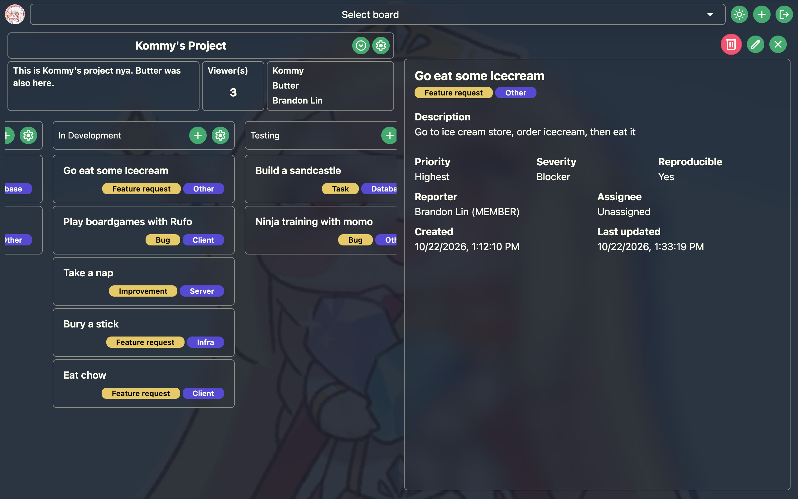
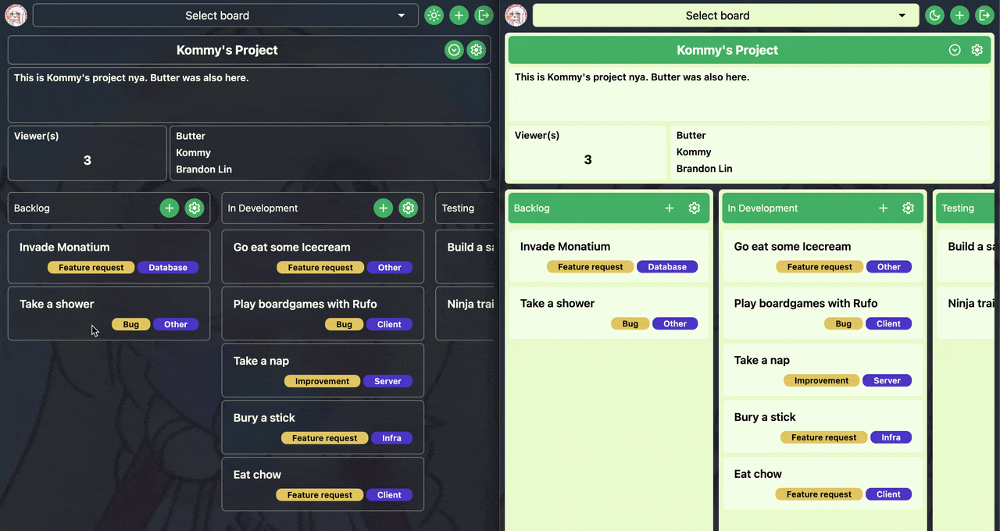

# Trickcal Bug Tracker

<h3 align="center">A Kanban board where your whole team stays in sync. Every change shows up instantly for everyone.</h3>

<p align="center">
    
</p>

## Live Demo

https://trickcal-bug-tracker.netlify.app/

## Tech Stack

- **Frontend:** React 19, TypeScript, Vite, Tailwind CSS, TanStack Query, React Router, Motion, Sonner (hosted on Netlify)
- **Backend:** Node.js, Express 5, Socket.IO, Passport.js, Prisma, Zod (hosted on Suga)
- **Data:** PostgreSQL (Neon), Redis (Redis Cloud)
- **Tooling:** pnpm workspaces, Turborepo, Docker Compose, NGINX, Vitest

## App Features

- Real-time sync:
    - Every change appears instantly for everyone viewing the board
        - Changes: (create/edit/delete/move for tickets, sections, boards, plus adding/removing collaborators)
    - Toast notifications for who performed what action
- Drag-and-drop: move tickets between sections with instant, live reordering
- Presence tracking: see who is currently viewing a board
- Boards, sections, and tickets: create, edit, and delete them
- Collaborators: add or remove people on a board
- Ticket assignees: assign or unassign people on a ticket
- Auth: Sign up / log in with Google OAuth, GitHub OAuth, or username and password
- Theming: Dark and light mode
- Responsive design: works on both mobile and desktop screens

<p align="center">
    
</p>

## Implementation Features

- Shared package
    - Single source of truth for the API contract between client and server
    - Type-safe DTOs returned by every endpoint and socket event
    - Zod validation schemas for request bodies, responses, and socket payloads
    - Shared error definitions, thrown by the server and handled by the client
    - Socket.IO events (client-to-server and server-to-client) defined once with typed payloads
- Backend
    - Prisma schema defines the data model
    - Endpoints and socket events manipulate data and return DTOs defined in shared
    - JWT-based user state
    - Redis powered Rate limiting by IP and username
    - Socket.IO events that broadcast every board, section, and ticket operation, and handle ticket moves
    - Fractional indexing for ticket ordering
    - Horizontal scaling for oauth sessions and Socket.IO using Redis
    - CRUD API for boards, sections, and tickets
- Client
    - Consumes shared DTOs for type-safe data handling
    - Validates server responses and outgoing payloads with shared Zod schemas
    - TanStack Query for API requests and caching, with query invalidation driven by Socket.IO events
    - Optimistic updates on ticket move with rollback on failure
    - Responsive layouts with Tailwind CSS breakpoint utilities
    - Motion for animated entry/exit
    - Sonner for toast notifications
- Repository / infrastructure
    - pnpm workspaces monorepo with Turborepo
    - Repo-wide build commands for local development
    - Docker Compose environment (PostgreSQL, Redis, Node.js server, React client served by NGINX)

## Repo structure

```
root/
├── pnpm-workspace.yaml
├── turbo.json
├── tsconfig.base.json
├── tsconfig.json
├── package.json
├── packages/
│   └── shared/
└── apps/
    ├── server/
    └── client/
```

## Start Commands

```bash
# Start container env
#   server exposed on host localhost:3000
#   client exposed on host localhost:5173
#   db exposed on host port 5433
$ docker compose up
$ docker compose up -d --build
$ docker compose down

# Local build
$ pnpm install
$ turbo build
$ turbo start
$ turbo dev
```

## Endpoints & Socket Events

Auth required for all endpoints & socket events execept /auth routes

### Endpoints

| Method | URI                                            | Function                   | Body (inputs)                                                                                  | Outputs                        | Notes                                                                           |
| ------ | ---------------------------------------------- | -------------------------- | ---------------------------------------------------------------------------------------------- | ------------------------------ | ------------------------------------------------------------------------------- |
| POST   | /auth/signup                                   | Signup                     | { username, password, name }                                                                   | userDto                        | password: { 8 - 16 characters, uppercase, lowercase, number, special character} |
| POST   | /auth/login                                    | Login                      | { username, password }                                                                         | { token }                      |                                                                                 |
| POST   | /auth/login/demo                               | Demo User Login            |                                                                                                | { token }                      |                                                                                 |
| POST   | /auth/github                                   | GitHub oauth2 login/signup |                                                                                                |                                | Login with GitHub oauth. Creates an account if no account exists                |
| POST   | /auth/github/callback                          | GitHub oauth2 callback     |                                                                                                | { token }                      | Callback to receive token after successful authorization                        |
| POST   | /auth/google                                   | Google oauth2 login/signup |                                                                                                |                                | Login with Google oauth. Creates an account if no account exists                |
| POST   | /auth/google/callback                          | Google oauth2 callback     |                                                                                                | { token }                      | Callback to receive token after successful authorization                        |
| GET    | /users/me                                      | Get logged in user info    |                                                                                                | userDto                        |                                                                                 |
| GET    | /boards                                        | get boards                 |                                                                                                | boardDto[]                     |                                                                                 |
| POST   | /boards                                        | create boards              | { name, description }                                                                          | boardDto                       | name: { min: 1, max: 100 }, description: { min: 0, max: 1000 }                  |
| GET    | /boards/:boardId                               | get board by id            |                                                                                                | boardWithSectionsAndTicketsDto |                                                                                 |
| PATCH  | /boards/:boardId                               | patch board                | { name?, description? }                                                                        | boardDto                       | see POST /boards                                                                |
| DELETE | /boards/:boardId                               | delete board               |                                                                                                | boardDto                       | must be owner to delete board                                                   |
| POST   | /boards/:boardId/collaborators                 | add collaborator           | { collaboratorId }                                                                             | boardDto                       | must be owner to add collaborator                                               |
| DELETE | /boards/:boardId/collaborators/:collaboratorId | delete collaborator        |                                                                                                | boardDto                       | must be owner to delete collaborator                                            |
| GET    | /boards/:boardId/collaborators/available       | get new collaborators      |                                                                                                | userDto[]                      | must be owner to fetch available new collaborators                              |
| POST   | /boards/:boardId/sections                      | create section             | { name, previousSectionId }                                                                    | sectionDto                     |                                                                                 |
| POST   | /boards/:boardId/sections/:sectionId/tickets   | create ticket              | { issueType, category, reproducibility, summary, description, priority, severity, assigneeId } | ticketDto                      |                                                                                 |
| PATCH  | /sections/:sectionId                           | edit section               | { name }                                                                                       | sectionDto                     | name: { min: 1, max: 26 }                                                       |
| DELETE | /sections/:sectionId                           | delete section             |                                                                                                | sectionDto                     |                                                                                 |
| PATCH  | /tickets/:ticketId                             | update ticket              | { issueType, category, priority, severity, reproducibility, summary, description }             | ticketDto                      |                                                                                 |
| PUT    | /tickets/:ticketId/assignee                    | update ticket assignee     | { assigneeId }                                                                                 | ticketDto                      | assignee must have board access                                                 |
| DELETE | /tickets/:ticketId                             | delete ticket              |                                                                                                | ticketDto                      |                                                                                 |

<br>

### Client to Server Socket Events

| Client to server socket event | Arguments                                           | Use               | Callback args                            |
| ----------------------------- | --------------------------------------------------- | ----------------- | ---------------------------------------- |
| 'connection'                  | token                                               | connect socket    |                                          |
| 'disconnect'                  |                                                     | disconnect socket |                                          |
| 'board:join_room'             | { boardId }, callback                               | join board room   | { success: boolean, viewers: userDto[] } |
| 'ticket:move'                 | { ticketId, sectionId, previousTicketId }, callback | move ticket       |                                          |

<br>

### Server to Client Socket Events

| Server to client socket event | Payload                                 | Use                                 | Listener args   |
| ----------------------------- | --------------------------------------- | ----------------------------------- | --------------- |
| 'board:user-joined-room'      | { user }                                | notify user joined room             | userId, viewers |
| 'board:user-left-room'        | { userId }                              | notify user left room               | userId, viewers |
| 'board:edited'                | { board }                               | notify board name/desciption edited |                 |
| 'board:deleted'               | { board }                               | notify board deletion               |                 |
| 'board:added-collaborator'    | { user, board }                         | notify board collaborator added     |                 |
| 'board:removed-collaborator'  | { user, board }                         | notify board collaborator deleted   |                 |
| 'section:created'             | { boardId, section }                    | notify section created              |                 |
| 'section:edited'              | { boardId, section }                    | notify section edited               |                 |
| 'section:deleted'             | { boardId, section }                    | notify section deleted              |                 |
| 'ticket:created'              | { boardId, ticket }                     | notify ticket created               |                 |
| 'ticket:updated'              | { updatedBy, ticket }                   | notify ticket updated               |                 |
| 'ticket:updated-assignee'     | { updatedBy, previousAssignee, ticket } | notify ticket assignee updated      |                 |
| 'ticket:moved'                | { movedBy, previousSectionId, ticket }  | notify ticket moved                 |                 |
| 'ticket:deleted'              | { deletedBy, ticket }                   | notify ticket deleted               |                 |

## Neat Bugs

- Database Prisma migration desync
    - Developing on local DB and testing on docker container DB instance causes migration drift
    - On docker compose server startup, execute prisma migration deploy to ensure DB sync
- Instanceof does not work on data received server!
    - Network serialization (JSON) strips prototype chains
    - Instanceof works by checking of our objects prototype is the same instance as the constructors
        - Object.getPrototypeOf(obj) === Constructor.prototype
- Infinitely joining room
    - Root cause: Forgot to use useCallback on joinRoom function
    - everytime a state updates, joinRoom is recreated
    - joinRoom is called again each time it is recreated
- Debugging circular import with vite --debug hmr
- Repeated auth check on every window refocus
    - Login page checks if user is logged in already by checking if token exists & calling /me
    - Tanstack refires on window refocus by default
    - Result: Loading animation displayed while auth checking displayed on every window refocus
    - Solution: create new query which doesnt refire on refocus for auth checking

# TODO

- demo route
    - populate demo data
    - client try demo button
